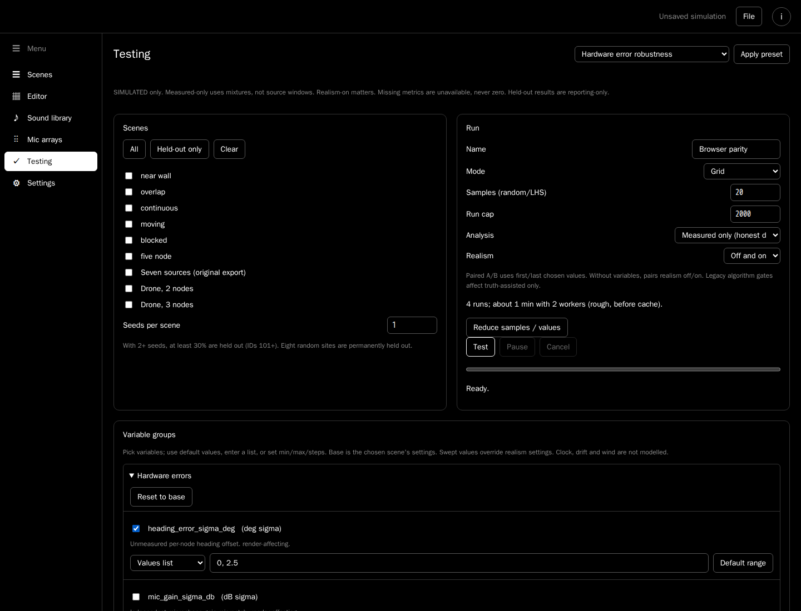
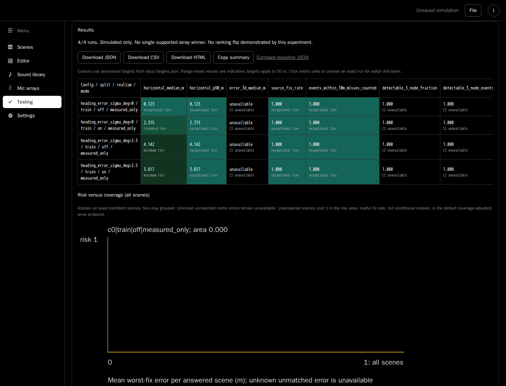

# Overnight localisation report

## Outcome and scope

The shared benchmark engine and usable Testing workspace are delivered. The
measured pipeline's PHAT-quality unit mismatch is repaired. It now produces
actual fixes; this does **not** make its conditional accuracy a trustworthy
hardware recommendation. Most requested localisation/realism upgrades remain
unfinished. Two attractive solver changes were rejected because suspect
precision/recall regressed.

Work is on `overnight/localisation`, never main. Existing signal and analysis
goldens are unchanged. The opt-in maximum-volume four-mic layout has its own new
signal golden. Schema is 0.13; every report includes exact producer/source,
runtime, settings, audio hashes, seeds, effective variable values and targets.
The running decision record is [overnight-log.md](overnight-log.md).

## Baseline versus final

`baselines/baseline-0.json` preserves the original 300-run inference unchanged.
`baseline-0-v2.json` explicitly re-scores those same inference objects under the
corrected episode convention. `final-0.json` completed all 300 cases with zero
tracked regressions; all 150 truth-assisted score objects are deeply identical
to the re-scored reference. Current-source `final-1.json` also completed
**300/300 with zero regressions,300 audio hits and0ms render**. All300 inference
and score objects, and all non-runtime summary values/CIs, deeply match
`final-0`. Runtime differs legitimately under concurrent compute.

There are 25 sites and seeds 1/2/101. Eight site IDs (32%) and seed101 (33%) are
held out; a run is held out if either its site or seed is held out. Each row has
34 train or 41 held-out runs. Realism on means heading2.5deg, gain1dB,
position5mm, correlation0.3. No thresholds were chosen from held-out outcomes.

| Split | Realism | Pipeline | Baseline median / p90 m | Final median / p90 m | Scene fix: baseline → final | Final source coverage |
|---|---|---|---|---|---|---|
| Train | Off | measured_only | unavailable | 0.5261 / 24.6307 | 0% → 70.59% | 62.07% |
| Train | On | measured_only | unavailable | 6.8735 / 24.8845 | 0% → 67.65% | 56.90% |
| Held-out | Off | measured_only | unavailable | 0.4380 / 21.7738 | 0% → 51.22% | 50.94% |
| Held-out | On | measured_only | unavailable | 2.4937 / 26.7466 | 0% → 31.71% | 32.08% |
| Train | Off | truth_assisted | 1.6770 / 25.8693 | 1.6770 / 25.8693 | 94.12% → 94.12% | 82.76% |
| Train | On | truth_assisted | 8.3466 / 27.5313 | 8.3466 / 27.5313 | 94.12% → 94.12% | 82.76% |
| Held-out | Off | truth_assisted | 1.7872 / 15.0851 | 1.7872 / 15.0851 | 68.29% → 68.29% | 66.04% |
| Held-out | On | truth_assisted | 4.3903 / 42.3812 | 4.3903 / 42.3812 | 68.29% → 68.29% | 67.92% |

Unavailable baseline errors mean **no fixes**, not zero error. Error quantiles
exclude misses. The held-out measured realism-on median looks good partly because
only 31.71% of scenes have any fix. Neither pipeline meets the provisional p90
10m target on these mixed-range populations.

| Split / realism | Measured median 95% CI m | Measured p90 95% CI m | Wrong fixes | Suspect recall / precision | Bearing within 1σ / 2σ | Track fixes / median m |
|---|---|---|---|---|---|---|
| Train / off | 0.1891–2.3825 | 7.3130–26.9827 | 28.33% | 100% / 28.33% | 76.85% / 76.85% | 5353 / 0.5261 |
| Train / on | 3.8165–9.2475 | 20.7556–28.5754 | 40.38% | 100% / 40.38% | 22.34% / 50.00% | 4697 / 5.8739 |
| Held-out / off | 0.3471–1.9955 | 8.0020–69.9555 | 23.08% | 100% / 23.08% | 81.08% / 82.43% | 3478 / 0.3169 |
| Held-out / on | 1.8908–9.3699 | 3.1309–47.9952 | 24.14% | 100% / 24.14% | 50.00% / 78.85% | 2229 / 1.9676 |

Every measured fix is currently a low-confidence two-node fix. Flagging all of
them gives 100% recall but does not discriminate wrong fixes. Track fixes are
time samples, not independent tracks/sources. Bootstrap units are scene/seed
runs; shared site geometry means these are not independent-site population CIs.
Measured calibration compares per-node track-median error with an assumed
2.5deg uncertainty, not every window. Measured elevation, 3D error and benchmark
labelling accuracy remain unavailable.

### Failure atlas

The full reports partition the atlas by split, realism and analysis mode.
Realism-on measured training has 46 bad episodes/missed sources: overlap31,
aerial4, near-wall3, low-SNR3, moving2, bad-geometry2, blocked1. Held-out has43:
random-site23, overlap15, aerial2, moving1, near-wall1, bad-geometry1.
Typical wrong overlap errors are21.61m train and30.84m held-out. All23 random-site
failures in that held-out partition are misses. These counts are not unique
scene probabilities.

## Kept and rejected steps

| Step | Decision and evidence |
|---|---|
| Shared engine/CLI | Kept: deterministic JSON experiments, five sampling modes, bounded workers, cancellation/resume, audio/result caching, bootstrap metrics, paired tests, atlas and JSON/CSV/HTML. Original300 baseline retained. |
| Measured PHAT quality | Kept: raw peak maximum below0.015 was compared with0.25. Normalise by fully coherent in-band peak; unchanged0.25 placeholder gate. Restores fixes without changing PCM, TDOAs or legacy bearings. Poisoned-truth regression requires actual tracks. |
| Testing | Kept: actual browser/CLI four-run equality, pause/reopen/resume, saved runs, download and exact editor drill-down verified. App32 tests and build pass. |
| Renderer provenance/reuse | Kept: separate parsed render dependency hash, producer sidecars, guarded150-input legacy reuse; independent cold control matches every mic/path/activity byte. Final300 audio hits,0ms render; not a cold-speed claim. |
| Episode scoring | Kept: disjoint bursts may match the same physical source. Removed a false50% wrong-fix result; this is corrected measurement, not better inference. All300 original inference objects preserved. |
| Maximum-volume four-mic choice | Kept opt-in A1/C1/C2/C3, volume299297.648mm³. Exhaustive495 subsets, own golden. Old coplanar layout and defaults unchanged; no acoustic superiority claim. |
| Bounded cache | Kept: completed render groups may discard raw audio, retain whole results. Interrupted groups retain raw. No cross-process lease; concurrent discard studies require separate caches. |
| Weight-aware positive-range consensus | Rejected: train seven-source median21.5058→11.0777m and p9036.4976→26.7930m, but recall66.67→50% and precision80→40%. No implementation retained. |
| Predictive leave-one-out covariance | Rejected: median21.5058→13.2270m, p9036.4976→32.9615m, tracks20→21; recall66.67→60%, precision80→60%. Exact transformed-source evidence retained; repository solver untouched. |
| Gain-model check | Kept regression/documentation: positive scalar gain scales signal plus both noise terms and ideally cancels in PHAT. Core244 and smoke16 passed, zero regressions. |
| Protected cap reduction | Kept: five→three seeds no longer drops both held-out IDs. Default array preset keeps9 arrays/1800 runs rather than5/1500. Core246, app32/build/browser parity; smoke16 zero regressions;11 declared study populations unchanged. |
| CI | Kept: real remote workflow41769397157 passed core243, app31/build and eight measured regression cases on pinned Node24.22.2. Later local counts reflect added tests, not skipped CI cases. |
| CLI argument safety | Kept: no-compute help and early strict failures. Core248, app32/build and final300 zero regressions. Previously `--help` silently started smoke. |

### Known-bug investigations, not false completion claims

The exact training s8 trace shows n1/n3 joint-refit residuals0.03899/0.01945σ,
but leave-one-out rejection-time residuals160.45496/24.50194σ. The export
recalculates rejection residuals at the **final surviving** point, not the point
that triggered rejection. Tiny-weight n2/n7 survive. This explains the misleading
residual field and confirms the structural failure; the exact reported0.4 case
was not reproduced. See `docs/experiments/consensus-trace.json`.

The available s1 replay already has four legacy track fixes; the reported zero-fix
case was not reproduced. s12's21.5058m unflagged legacy fix remains.
Historical schema0.4/0.6 revisions are unavailable, so their bearing change is
not proven explained. Browser/Node tests did reproduce near-zero consensus tie
instability despite identical PCM and whole-event bearings; schema numbers
themselves are not an algorithm.

## Array experiments

The complete144-run pilot compares all9 arrays on two sites, seeds1/101,
both pipelines and realism profiles. JSON is losslessly archived at
`baselines/array-pilot.json.gz`; CSV/HTML are readable without extraction.
Use `gzip -dk baselines/array-pilot.json.gz` before a JSON CLI comparison.

Pilot point-median leaders are **not hardware winners**:

| Split | Pipeline | Realism off leader | Realism on leader |
|---|---|---|---|
| Train | measured_only | planar12_d180 | flat4_100 |
| Held-out | measured_only | planar12_d180 | planar12_d180 |
| Train | truth_assisted | dome12_d230 | ball12_d180_sub6 |
| Held-out | truth_assisted | puck12_d210 | ball12_d180 |

There is only one train site/seed per profile in that pilot. Coverage, tails,
uncertainty, horizontal-only inference and unmodelled housing prevent a hardware
recommendation. Realism changes the point leader in three pilot partitions.

The original1350 full study was gracefully cancelled at167 runs based on
**stage timing, before array accuracy inspection**. Its explicitly cancelled
`array-full-partial` archive must not rank unequal populations. The predeclared
900-run replacement retains all25 sites/all9 arrays, both profiles, seeds1/101,
306train/594held-out; 32% site IDs and50% seeds are held out.
Its completion and the eight fixed endpoint sensitivity grids remain pending
at this draft checkpoint. No endpoint values are tuned from outcomes.

No clock model/sensitivity or measured elevation ranking is claimed. Gain
insensitivity is partly built into the renderer. The nominal aliasing limit is
a geometry heuristic, not validated wideband performance. `targets.json` retains
provisional median5m/p9010m to50m targets; calibrated mic-noise, clock or heading
hardware requirements cannot honestly be derived from this incomplete physics.

## Use Testing

1. Open the simulator and select **Testing** in the side menu.
2. Choose scenes, seeds and variable groups, or click a preset. The estimate
   appears before **Test**; **Reduce samples / values** preserves held-out seeds.
3. Click **Test**. Workers keep the page responsive. Pause/resume or cancel;
   reopen a saved run to resume matching completed jobs.
4. Read coverage alongside conditional errors. Use line/heatmap/tornado views,
   array ranking/flip checks and saved/baseline comparisons. Click a metric cell
   for exact scene/seed drill-down. Download JSON for durable provenance.

These are actual headless-browser screenshots. Small-sweep browser/CLI parity,
saved resume and drill-down were executed, not merely unit-tested. Pressing the
editor's existing **Create** still runs its legacy truth-assisted analysis; it
does not recreate measured benchmark inference. Browser storage is not archival.
See [testing.md](testing.md) for all groups, presets, charts and extension points.

## Honest limits and deferred work

| Surface | Status / trust boundary |
|---|---|
| Legacy analysis | Truth-assisted windows/start times, in-window SNR/overlap, chosen path, multipath and track-dominance remain. Explicitly labelled upper bound. |
| Measured inference | Mixtures, nominal geometry/settings and measured windows only. Poisoned-truth test guards boundary. Horizontal two-node association; misses, duplicates and overconfidence remain. |
| Scoring | Truth allowed after inference. Greedy spatial assignment is one-to-one only for overlapping emission intervals, without clip-active interval checks. |
| Uncertainty | No hardware-calibrated uncertainty, fix covariance/ellipse or heading self-calibration added. Blocked-direct0.8deg/83deg-type overconfidence is not fixed. |
| Consensus/suspect | Both proposed repairs rejected. No blocked-ray map term/edge association or improved discriminating suspect gate is claimed. |
| Physics | No new timing/drift, coloured site noise, wind/rain, phase/frequency mismatch, housing scattering or source directivity. Scalar gain is especially limited. |
| Algorithms | No new multi-peak association, multi-track filter, ground-bounce elevation, trusted aerial3D or inter-node timing constraint. Existing measured EKF is not a new upgrade. |
| Labelling | Real YAMNet/CLAP clean-clip tests ran. Benchmarks do not run models; accuracy null. Exports include labelling only when actual results exist, never a fake block. |
| Product tools | Coverage placement, real-WAV/external-track ingestion and fitted real-recording calibration deferred. |
| Statistics/runtime | Shared-site run bootstrap, exploratory paired tests without multiplicity adjustment, legacy JS-runtime tie instability. Cached runtime is original execution, not current wall time. |
| Provenance | Original dirty-tree audio migration includes parsed dependency/PCM/cold-control audit, not a fully committed historical renderer checkout. Full producer identities are preserved. |

## Review order

Review chronological logical commits; each can be reverted separately:

1. `bc8bfa0` shared benchmark engine.
2. `d8d4a34` measured PHAT units and benchmark identity.
3. `9f6ffe8` Testing workspace.
4. `c8d2730` audited renderer reuse/single-flight.
5. `a0c1baa` corrected episode scoring.
6. `3147055` opt-in maximum-volume subset.
7. `7cbd225` bounded sequential raw cache.
8. `716cf17` original baseline and fixed endpoint protocols.
9. `c769ac0` original full-array protocol.
10. `68c5ff5` finite measured CI.
11. `208a8e2` consensus decision trace.
12. `9810beb` full grading/rejected covariance evidence.
13. `ae743d6` scalar-gain assumption regression.
14. `5b43a75` complete pilot, honest partial and budget protocol.
15. `69397f2` protected holdout/cap reduction.

Later verification/data/report commits will be appended at finalisation. Neither
rejected solver is present. No retained commit is deliberately marked unmergeable,
but data commits are large and do not certify hardware readiness. Merge the
scoring convention and its explicit baseline together.

## Open decisions for later

- Obtain the exact historical schema0.4/0.6 exports, scenes/settings and source
  revisions before claiming the bearing change or zero-track report solved.
- Measure housing/phase response, environmental spectra and clock/heading errors
  on a real prototype before using conditional simulation leaders to buy hardware.
- Define acceptable coverage and wrong-fix precision, not just point-error
  targets, before accepting a consensus change that trades safety for coverage.
- Separate independent-site validation and real-recording calibration from
  repeated-seed confidence intervals.
